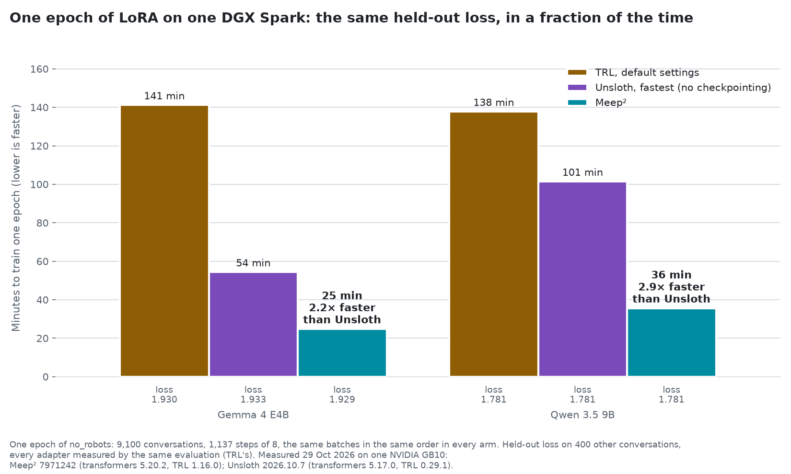
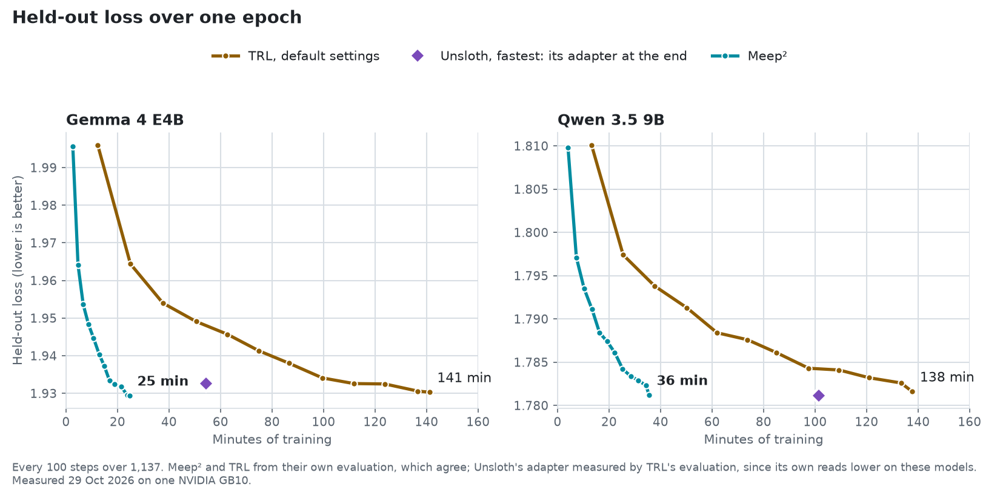

<h1>
  <picture>
    <source media="(prefers-color-scheme: dark)" srcset="https://raw.githubusercontent.com/thinkube/meepsquared/main/assets/meepsquared-logo-dark.svg">
    
  </picture>
</h1>

**Fast LoRA and QLoRA fine-tuning on Hugging Face Transformers, PEFT and TRL, under permissive licenses.**

[Documentation](https://thinkube.org/meepsquared/) · [Benchmarks](https://thinkube.org/meepsquared/benchmarks.html) · [Licensing](https://thinkube.org/meepsquared/licensing.html) · [Notebooks](notebooks/)

## What Meep² is

Meep² is an easy-to-use LoRA and QLoRA fine-tuning engine for Hugging Face models: you name the model, the data and the method, and it decides the rest. It measures your model, your data and your GPU, and prints a plan with the reason for each choice. It trains with TRL's own trainers and reaches the same loss as TRL, 2.2 to 2.9 times faster than Unsloth over a full epoch on this year's architectures, with the parameters it sets automatically. It runs on one GPU or several in one machine, including GPUs that share memory with the CPU, such as the DGX Spark.

<picture>
  <source media="(prefers-color-scheme: dark)" srcset="assets/epoch-dark.png">
  
</picture>

<picture>
  <source media="(prefers-color-scheme: dark)" srcset="assets/epoch-loss-dark.png">
  
</picture>

Every number on this page comes from a script in [`benchmarks/`](benchmarks/), on public models and data, and every run is recorded in [`benchmarks/results/`](benchmarks/results/). If you measure something different, open a [benchmark result](https://github.com/thinkube/meepsquared/issues/new?template=benchmark-result.md) issue.

## Install

You need:

- an NVIDIA GPU of the Ampere generation or later: RTX 30 series or newer, A100, H100, or the DGX Spark. Meep² is tested on the DGX Spark's GB10 and on the RTX 3090; older GPUs, such as the GTX 10 and RTX 20 series, are not supported;
- Python 3.12;
- PyTorch 2.11 with CUDA, installed before Meep².

**With pip**, on Linux, x86-64 or ARM (the DGX Spark):

```bash
pip install torch==2.11.0 --index-url https://download.pytorch.org/whl/cu130
pip install meepsquared
```

Meep² installs the versions it is tested with: Transformers 5.20.2, TRL 1.16.0, PEFT 0.21.2 and the rest. FlashAttention is optional: without it, Meep² uses PyTorch's own attention, which is slower on Llama-style models.

**With the container**, which has PyTorch 2.11, FlashAttention and Triton built for your GPU by NVIDIA. You need Docker or Podman (replace `docker` with `podman`) and the NVIDIA Container Toolkit, which the DGX Spark already has:

```bash
git clone https://github.com/thinkube/meepsquared
docker build -t meepsquared -f meepsquared/Containerfile meepsquared
```

Then run a training job from the folder that holds it:

```bash
docker run --rm -it --gpus all -e HF_TOKEN \
  -v ~/.cache/huggingface:/root/.cache/huggingface -v "$PWD":/work -w /work \
  meepsquared meepsquared train job.yaml        # or: meepsquared python train.py
```

`HF_TOKEN` is your Hugging Face token, needed for gated models such as Llama; the cache mount keeps downloaded models between runs; the current folder is the container's `/work`, so the trained adapter appears in it. No prebuilt image is published, because NVIDIA's container comes under NVIDIA's license terms.

For GRPO with vLLM inside the trainer, vLLM and PyTorch must be the same pair; the [GRPO page](https://thinkube.org/meepsquared/grpo.html#_installing_vllm) says which vLLM goes with which PyTorch, including the wheels built for NVIDIA's container and the DGX Spark.

## Train

You describe the training job: the model, the data, and the method. Meep² decides how to train it. Save this as `train.py` and run `python train.py`, or with the container as above:

```python
import meepsquared as m2

job = m2.TrainingJob(
    model="Qwen/Qwen3.5-9B",
    data="HuggingFaceH4/no_robots",   # a Hugging Face dataset id, a .jsonl, .json or .parquet file, or a datasets.Dataset
    method="lora",                     # "lora", "qlora" (4-bit weights) or "fp8" (8-bit weights)
    steps=1000,                        # or epochs=1
)

print(job.plan())     # what meepsquared will do on this machine, and why; nothing is trained yet
result = job.train()  # prints the plan, then trains with TRL
result.save("out")    # the adapter; result.save("out", merged=True) for a 16-bit model
```

This is auto mode. Meep² measures the model, the batch and the machine, and decides how to train on it: how the model loads, how the batch is packed, which kernels run, how many layers are recomputed to save memory, the batch size and the learning rate. The plan prints each decision with its reason. You can change any of them with `m2.Recipe` (the training choices) or `m2.Overrides` (the hardware choices); the plan then shows your choice beside Meep²'s.

The same job can be written as YAML and run from the command line:

```yaml
# job.yaml
model: Qwen/Qwen3.5-9B
data: HuggingFaceH4/no_robots
method: lora
steps: 1000
```

```bash
meepsquared train job.yaml --plan-only   # print the plan and stop
meepsquared train job.yaml               # print the plan, train, and save the adapter
meepsquared train job.yaml --status-file status.json --stop-file STOP [--resume]
                                    # train in sessions: stop with a checkpoint when STOP exists
                                    # (exit code 75), and resume exactly where it stopped
```

On a GPU the plan times a few steps and states how long the training will take.

Underneath, Meep² trains with TRL's own trainers. `job.trainer()` gives you TRL's `SFTTrainer` or `GRPOTrainer`, set up as `job.train()` would run it, when you want TRL's full control. The [training jobs page](https://thinkube.org/meepsquared/training-job.html) lists every field and every default, with its source.

A training job also puts LoRA on the experts of a mixture of experts (`Recipe(experts=True)`), trains GRPO (`task="grpo"`, with your reward functions in `rewards=[...]` and 8 completions per prompt unless `Recipe(generations=...)` says otherwise), with vLLM generating inside the trainer if you want (`Overrides(vllm=True)`), and trains with DDP on several GPUs under `torchrun`. FSDP2 and a model spread over several GPUs use Meep²'s lower-level calls, which the [documentation](https://thinkube.org/meepsquared/) shows. Code written for Unsloth also runs on those calls, after a change of its import lines ([what differs](https://thinkube.org/meepsquared/from-unsloth.html)).

## Numbers

One epoch of LoRA on one NVIDIA GB10 (DGX Spark): no_robots' 9,100 training conversations, 1,137 steps of 8, then the held-out loss of every adapter on 400 other conversations, all measured by the same evaluation (TRL's).

| Model | Engine | Minutes | Peak GPU memory, GiB | Held-out loss |
|---|---|---|---|---|
| Gemma 4 E4B | TRL, default settings | 141.2 | 19.3 | 1.9303 |
| | Unsloth, fastest | 54.4 | 54.7 | 1.9326 |
| | **Meep²** | **24.7** | 32.3 | **1.9295** |
| Qwen 3.5 9B | TRL, default settings | 137.8 | 21.6 | 1.7815 |
| | Unsloth, fastest | 101.4 | 90.7 | 1.7811 |
| | **Meep²** | **35.5** | 39.5 | 1.7813 |

- **Gemma 4 and Qwen 3.5**, this year's architectures: over a full epoch, Meep² is 2.2 and 2.9 times faster than Unsloth at its fastest setting, and 5.7 and 3.9 times faster than TRL at its defaults, with the same held-out loss. Gemma 4 E4B has 35 sliding-window layers and 7 global layers with attention heads of 512, wider than FlashAttention computes; Qwen 3.5 9B computes 24 of its 32 layers with linear attention. Meep² packs their batches without padding through all of these layers and fuses their LoRA.
- **Llama 3.1**, the established architecture most benchmarks use: Meep² is slightly slower than Unsloth at its fastest, 1,633 against 1,662 tokens/s (three runs of 30 steps), and reaches the same held-out loss as TRL over 200 steps on two seeds (1.6905 and 1.6914 against 1.6907 and 1.6899).
- **"Unsloth, fastest"** is Unsloth with gradient checkpointing off. Meep² checkpoints only the layers the free memory requires, which on the GB10 is none, so those two compare like with like. **TRL** runs at its defaults: padded batches, every layer checkpointed; TRL with its own speed options on was not measured.
- **The held-out loss:** each engine's own evaluation reads differently on Gemma 4 and Qwen 3.5 (Unsloth's reads 0.008 to 0.013 lower, even before training), so every adapter was measured by the same evaluation. Meep²'s and TRL's own evaluations agree with it.
- All runs use no_robots, whose conversations are short and vary a lot in length. That is where packing without padding gains most, so on data of even lengths the lead is smaller.
- Measured 25 to 29 October 2026: Meep² at commit `7971242` (transformers 5.20.2, TRL 1.16.0; the short runs at `1375994`), Unsloth 2026.10.7 (transformers 5.17.0, TRL 0.29.1). Unsloth's releases up to 2026.10.10 require transformers 5.17 or older; we will compare again when Unsloth accepts 5.20.

<details>
<summary>Short runs: 30 steps, three runs each, LoRA and QLoRA, Llama included</summary>

Training tokens per second, mean of three runs; in brackets the peak GPU memory in GiB as PyTorch allocates it (Unsloth's default moves activations to CPU memory, which this does not count; on the GB10 it is the same memory). Below a value, the range of the three runs.

| Model, method | Released | TRL, default settings | Unsloth, default | Unsloth, fastest | Meep² |
|---|---|---|---|---|---|
| Gemma 4 E4B, LoRA | Mar 2026 | 291 (19.3) | 577 (18.5) | 769 (54.7)<br>758–776 | **1,903** (29.8)<br>1,898–1,907 |
| Qwen 3.5 9B, LoRA | Feb 2026 | 278 (21.6) | 278\* (29.4)<br>249–300 | 387\* (90.6)<br>373–395 | **1,253** (36.1)<br>1,252–1,255 |
| Gemma 4 E4B, QLoRA | Mar 2026 | 304 (12.9) | 553 (13.0) | 733 (49.2) | **1,738** (23.5)<br>1,731–1,748 |
| Llama 3.1 8B, LoRA | Jul 2024 | 308 (20.0) | 1,125 (16.2)<br>1,026–1,206 | **1,662** (28.7)<br>1,642–1,683 | 1,633 (28.5)<br>1,631–1,636 |
| Llama 3.1 8B, QLoRA | Jul 2024 | 326 (9.5) | 1,068 (6.7) | **1,494** (19.1)<br>1,473–1,505 | 1,461 (18.7)<br>1,452–1,470 |

\* With Unsloth's compiler off (`UNSLOTH_COMPILE_DISABLE=1`), as its Qwen 3.5 runs needed in this environment.

NVIDIA NeMo AutoModel, the library of NVIDIA's DGX Spark fine-tuning playbook, trained the Llama LoRA row at 5.68 s per step in 60.0 GiB (one run, with its own optimizer and order of the conversations), against Meep²'s 1.44 s in 27.8 GiB.

</details>

How each run was made, with the command of every arm, is in [`benchmarks/results/2026-10/`](benchmarks/results/2026-10/README.md). The charts are drawn from those files by [`benchmarks/make_readme_chart.py`](benchmarks/make_readme_chart.py).

### More results

<details>
<summary>Frozen weights in FP8, LoRA, 30 steps</summary>

With `method="fp8"` (in the lower-level calls, `load_in_fp8=True`), the base model's linear layers are stored in FP8, an 8-bit number format, instead of 16-bit BF16. Their products run on the GPU's FP8 tensor cores. The adapters stay in BF16.

| Model | BF16 weights | FP8 weights | Training loss, BF16 → FP8 |
|---|---|---|---|
| Llama 3.1 8B | 1,650 (27.8) | **1,908 (21.3)** | 1.857 → 1.862 |
| Qwen 3.5 9B | 1,263 (35.2) | **1,411 (28.8)** | 1.965 → 1.969 |

Single runs, at an earlier commit than the tables above. Over 200 steps on Llama, FP8 weights cost 0.003 in held-out loss and trained 12% faster in 17% less memory ([`number-formats-llama.jsonl`](benchmarks/results/2026-10/number-formats-llama.jsonl), an unfused setup used to compare number formats).

</details>

<details>
<summary>Mixture of experts: LoRA on every expert, Qwen3.6-35B-A3B, 30 steps</summary>

A mixture-of-experts model has many small MLPs, the experts, and sends each token to a few of them. Training a LoRA adapter on every expert is slow with PEFT alone: at each pass, PEFT builds the full adapted weight of every expert. Meep² instead computes each expert's adapter only on the tokens sent to that expert, in one kernel launch per product. The same kernel lets the expert weights be stored in FP8.

| Computation | Training tokens/s | Peak memory, GiB |
|---|---|---|
| PEFT's computation of the experts | 571 (569–575) | 80.1 |
| Meep², routed LoRA, BF16 weights | 777 (773–779) | 78.8 |
| Meep², routed LoRA, FP8 expert stacks | **857**, single run | **61.2** |

</details>

<details>
<summary>One RTX 3090, LoRA, 30 steps</summary>

| Model | TRL, default settings | Unsloth, default | Meep² |
|---|---|---|---|
| Gemma 4 E4B | 562 (19.3) | 776 (18.5) | **1,674** (18.0) |
| Llama 3.1 8B | 482 (20.0) | 1,231 (16.3) | **1,361** (21.0) |

On this card, checkpointing 16 of Llama's 32 layers by hand gave 1,458 tokens/s in 22.5 GiB, faster than the layout Meep² chose.

</details>

<details>
<summary>Two RTX 3090 over PCIe, no NVLink, 20 steps</summary>

Single runs. When a model fits on one GPU, DDP (distributed data parallel) trains a copy on each GPU, each on its own examples:

| Model, method | 1 GPU | 2 GPUs, DDP |
|---|---|---|
| Llama 3.1 8B, LoRA | 1,272 (16.6) | **2,247** (16.8) |
| Qwen 3.8 27B, QLoRA | 355 (20.2) | **633** (20.6) |

When a model does not fit on one GPU, FSDP2 splits every layer's weights across the GPUs, and the layer split puts half of the layers on each. Memory is given for each GPU.

| Model, method (29.5 GB of weights: not one 24 GB card) | 2 GPUs, FSDP2 | 2 GPUs, layers split |
|---|---|---|
| Qwen3-14B, LoRA, BF16 | 466 (18.2 + 18.1) | **698** (15.2 + 15.2) |

</details>

## What Meep² does

- **Auto mode:** a training job names the model, the data and the method; Meep² measures and decides the rest, and prints a plan with the reason for each decision. A job is also plain data, so a form or a platform can write it.
- **Fused LoRA kernels** for the attention projections and the MLP (Axolotl's, vendored). **Compiled layers** where compiling pays. **Gradient checkpointing measured for the batch**: Meep² measures one layer on the largest micro-batch the training runs, under three ways of training it (keeping everything, recomputed selectively, recomputed whole), and chooses a layout that fits the free memory. Selective recomputation keeps the outputs of a layer's products and recomputes only the cheap operations around them.
- **Frozen weights in FP8** on GPUs with FP8 tensor cores (Ada, Hopper, Blackwell). The adapters stay in BF16.
- **Mixture of experts:** LoRA on every routed expert with Meep²'s own grouped kernel, in BF16 or FP8. This matters on the GPUs where PyTorch has no grouped matrix-multiply kernel (consumer and workstation Blackwell, Ampere, Ada) and loops over the experts instead.
- **Padding-free batches** that keep the examples apart in the gated DeltaNet layers of Qwen 3.5 and 3.6, and for models whose attention heads are wider than FlashAttention computes (Gemma 4: heads of 512), on PyTorch's memory-efficient kernel. Chat templates are tokenized without stray spaces.
- **Several GPUs in one machine:** DDP, FSDP2, or the layers spread over the GPUs, with the right settings for each, tested on two RTX 3090 without NVLink. Training across two machines, such as two DGX Sparks, is not tested yet.
- **GPUs that share the system's memory** (DGX Spark): a checkpoint loads shard by shard and is never held twice in memory. The free memory is read the way the machine reports it.
- **Training in sessions:** a training stops with a checkpoint when a stop file appears or the process gets SIGTERM, resumes exactly where it stopped, and writes its progress to a status file that a scheduler or a platform can follow.
- **GRPO** with TRL's own `GRPOTrainer`. Where vLLM is installed, it generates inside the training process through `GRPOConfig`.
- **Saving** as an adapter, or merged into 16-bit weights. 4-bit and FP8 layers are converted back to 16 bits for the merge.

## Notebooks

Five tutorials in [`notebooks/`](notebooks/), from the simplest to the most involved. Each one explains the idea it uses. Notebooks 01 to 04 train with a training job; 05 uses the lower-level calls, for FSDP2 and a model spread over several GPUs, which a training job does not do. Each trains on a dataset of conversations that you can replace with your own: a Hugging Face dataset, a Parquet file or a JSONL file, with the number of epochs as a setting. Each loads its model from Hugging Face, or from the cluster's model mirror on [Thinkube](https://thinkube.org). On Thinkube it also records the run in Thinkube Experiments and can register the trained model so the cluster serves it.

| Notebook | What it teaches |
|---|---|
| [`01-lora-sft.ipynb`](notebooks/01-lora-sft.ipynb) | LoRA and QLoRA on a chat model: the adapter, the data, the loss on the answers only, saving and serving |
| [`02-fp8-weights.ipynb`](notebooks/02-fp8-weights.ipynb) | The frozen weights held in FP8: what FP8 is, what it costs, what it saves |
| [`03-moe-experts.ipynb`](notebooks/03-moe-experts.ipynb) | LoRA on every expert of a mixture of experts, with the expert weights in FP8 |
| [`04-grpo-zebra.ipynb`](notebooks/04-grpo-zebra.ipynb) | GRPO with a reward a program computes: a zebra puzzle graded by a constraint solver |
| [`05-several-gpus.ipynb`](notebooks/05-several-gpus.ipynb) | Several GPUs without NVLink: DDP when the model fits one, FSDP2 or a layer split when it does not |

The scripts that produced the numbers above are in [`benchmarks/`](benchmarks/); a notebook beside each one explains its settings and runs it:

| Notebook | What it measures |
|---|---|
| [`benchmarks/sft.ipynb`](benchmarks/sft.ipynb) | LoRA, QLoRA and FP8 weights on Llama 3.1 8B, Qwen 3.5 9B and Gemma 4 E4B: Meep², Unsloth and plain TRL on one GPU |
| [`benchmarks/moe.ipynb`](benchmarks/moe.ipynb) | LoRA on every expert of Qwen3.6-35B-A3B, with BF16 and FP8 expert weights, against PEFT's computation |
| [`benchmarks/multi_gpu.ipynb`](benchmarks/multi_gpu.ipynb) | Two consumer GPUs without NVLink: DDP for a model that fits one, FSDP2 and the layer split for one that does not |

## Built on, and license

Meep² is Apache-2.0 ([LICENSE](LICENSE), [NOTICE](NOTICE)). It is built on [Transformers](https://github.com/huggingface/transformers), [PEFT](https://github.com/huggingface/peft), [TRL](https://github.com/huggingface/trl) and [datasets](https://github.com/huggingface/datasets) (Apache-2.0), [Axolotl](https://github.com/axolotl-ai-cloud/axolotl)'s LoRA kernels (vendored, Apache-2.0), [bitsandbytes](https://github.com/bitsandbytes-foundation/bitsandbytes), [Triton](https://github.com/triton-lang/triton) and [flash-linear-attention](https://github.com/fla-org/flash-linear-attention) (MIT), and [Liger Kernel](https://github.com/linkedin/Liger-Kernel) and [FlashAttention](https://github.com/Dao-AILab/flash-attention) (BSD). certifi and tqdm, which requests and Transformers install, are MPL-2.0, which applies file by file. PyTorch and CUDA come from your environment under their own licenses. The [licensing page](https://thinkube.org/meepsquared/licensing.html) links each license file and compares the licenses of other training engines.

Meep² is the fine-tuning engine of [Thinkube](https://thinkube.org), a platform for running AI on your own hardware.
